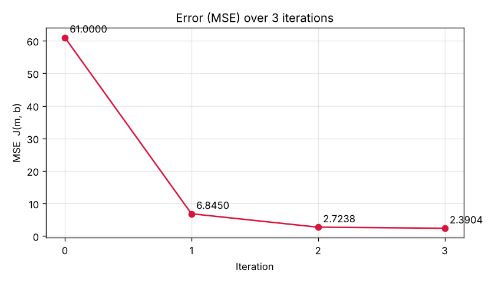

# Formative 3 — Probability Distributions, Bayesian Probability & Gradient Descent

| Member | Notebook they own (Git commits) | Part 3 — Gradient Descent Manual Calculation |
|---|---|---|
| Member 1 — *name* | Part 1 — Probability Distributions (EM Algorithm) | Update 2 |
| Member 2 — *name* | Part 2 — Bayesian Probability | Update 3 + trend summary |
| Member 3 — *name* | Part 4 — Gradient Descent in Code | Owner: setup, chain-rule derivation, update 1; scans the PDF |

## Repository layout

```
data/
  GaltonFamilies.csv                                  Part 1 data
  IMDB_Dataset.csv.gz                                 Part 2 data (compressed to fit GitHub)
notebooks/
  Part1_Probability_Distributions_EM_Algorithm.ipynb
  Part2_Bayesian_Probability_IMDb_Reviews.ipynb
  Part4_Gradient_Descent_in_Code.ipynb
docs/
  Part3_Gradient_Descent_Manual_Calculation_Handwritten.pdf       Part 3 handwritten, scanned (graded)
  Part3_Gradient_Descent_Manual_Calculation_TypedReference.pdf / .md   typed key to copy from
  Presentation_Questions_and_Answers.md, Team_Plan.md
images/                                               figures saved by the notebooks
```

## How to run

```bash
python -m venv .venv
source .venv/bin/activate          # Windows: .venv\Scripts\activate
pip install -r requirements.txt    # needs SciPy >= 1.15 for scipy.differentiate
jupyter notebook                   # open a notebook in notebooks/ and choose Run All
```

## Data

| Part | Dataset | What we checked |
|---|---|---|
| 1 | [Galton family heights](https://www.kaggle.com/datasets/jacopoferretti/parents-heights-vs-children-heights-galton-data) | 934 children, 205 families, heights in inches |
| 2 | [IMDb 50K Movie Reviews](https://www.kaggle.com/datasets/lakshmi25npathi/imdb-dataset-of-50k-movie-reviews) | 50,000 reviews: 25,000 positive, 25,000 negative |

---

## Part 1 — Probability Distributions: EM Algorithm (mixture of two Gaussians)

**Setup.** We chose **Fathers and Children**: 934 children's heights + 205 fathers' heights (one per family; the raw file repeats each father on every child's row). 1139 heights, labels hidden from the algorithm. Component 1 = Children, component 2 = Fathers (the brief's "Pros/Basketball Player" label comes from a template; here it is Fathers).

**Algorithm** (`notebooks/Part1_Probability_Distributions_EM_Algorithm.ipynb`)
1. **Initialization** — split at the global mean (67.21 in); each pile gives a starting mean, variance and mixing coefficient.
2. **E-step** — responsibility r = πₖ·N(x | μₖ, σₖ²) / Σⱼ πⱼ·N(x | μⱼ, σⱼ²): the probability each height belongs to each group (soft assignment).
3. **M-step** — new μₖ, σₖ², πₖ as responsibility-weighted averages.
4. **Stop** when the log-likelihood improves by less than 10⁻⁶ → converged after **309 iterations**.

**Tracking table** (printed by the code)

| Iteration | μ1 (Children) | μ2 (Fathers) | σ1² | σ2² | π1 | π2 | Log-Likelihood |
|---|---|---|---|---|---|---|---|
| 0 (Initialization) | 64.2598 | 70.2147 | 4.1428 | 3.5711 | 0.5048 | 0.4952 | −3071.1165 |
| 1 | 64.3784 | 70.0758 | 4.9168 | 4.2979 | 0.5033 | 0.4967 | −3053.5777 |
| 2 | 64.4368 | 69.9988 | 5.3058 | 4.6724 | 0.5017 | 0.4983 | −3049.7088 |
| 309 (final) | 64.1772 | 69.5186 | 5.3024 | 6.0410 | 0.4325 | 0.5675 | −3046.9895 |

**Should we split at the global mean and average each pile? No.**
- The cut misplaces **44 of 205 fathers** and **403 of 934 children**: the two bell curves overlap, so no single line separates them.
- Cutting chops off tails, so the piles look too narrow (sd 2.04 / 1.89 vs EM 2.30 / 2.46).
- The global mean is the wrong boundary: EM's 50/50 point is **66.54 in**, not 67.21.
- Hard labels hide uncertainty: 66.71 in is "100% child" for the cut, but **46.1% / 53.9%** for EM.
- EM starts from that split and improves the log-likelihood from −3071.12 to −3046.99.

**What EM found** (hidden labels used only to check): the Children component is 92% children (mostly daughters); the Fathers component holds 81% of the fathers but also most sons — Galton's children are adults, and sons (69.2 in) are as tall as fathers (69.3 in).

**Test-height demo:** type the coach's value into `TEST_HEIGHT` (last cell of the Part 1 notebook) and run it, e.g. 70 in → P(Children) = 0.0328, P(Fathers) = 0.9672.


## Part 2 — Bayesian Probability (IMDb movie reviews)

Notebook: `notebooks/Part2_Bayesian_Probability_IMDb_Reviews.ipynb`

Direction chosen: **P(Positive | keyword)** for all keywords. Basic Python only (`csv`, `gzip`, `string`). A review "contains" a keyword if the word appears at least once after lower-casing and removing punctuation and `<br />` tags.

| Keyword | Prior P(Positive) | Likelihood P(kw\|Positive) | Marginal P(kw) | Posterior P(Positive\|kw) |
|---|---|---|---|---|
| excellent | 0.5000 | 2868/25000 = 0.1147 | 3552/50000 = 0.0710 | **0.8074** |
| wonderful | 0.5000 | 2258/25000 = 0.0903 | 2780/50000 = 0.0556 | **0.8122** |
| superb | 0.5000 | 1026/25000 = 0.0410 | 1199/50000 = 0.0240 | **0.8557** |
| worst | 0.5000 | 411/25000 = 0.0164 | 4434/50000 = 0.0887 | **0.0927** |
| waste | 0.5000 | 175/25000 = 0.0070 | 2534/50000 = 0.0507 | **0.0691** |
| awful | 0.5000 | 284/25000 = 0.0114 | 2882/50000 = 0.0576 | **0.0985** |

Why these: each positive word moves the probability from 0.50 to above 0.80, each negative word below 0.10, and each occurs in 1,199–4,434 reviews. Rejected after testing: *great* (0.6741, in 4,099 negative reviews), *bad* (0.2511, "bad guy" in 382 positive reviews), *masterpiece* (0.7274, often praises another film), *boring* (0.1940).

## Part 3 — Gradient Descent Manual Calculation (by hand)

Handwritten, at least one update per member (Member 3: setup, chain rule, update 1; Member 1: update 2; Member 2: update 3 and trend): `docs/Part3_Gradient_Descent_Manual_Calculation_Handwritten.pdf` (scanned). Typed key: `docs/Part3_Gradient_Descent_Manual_Calculation_TypedReference.pdf`.
Matrix form: ŷ = Xm + b, J = (1/n)Σ(ŷ − y)², ∂J/∂m = (2/n)Xᵀ(ŷ − y), ∂J/∂b = (2/n)·Σ(ŷ − y), learning rate α = 0.01.

| Update | m after | b after | J before update |
|---|---|---|---|
| 1 | [−1.45, 0.87] | 0.88 | 61 |
| 2 | [−1.3316, 1.1808] | 0.9318 | 6.845 |
| 3 | [−1.369562, 1.095182] | 0.93624 | 2.72381716 |

After update 3, J = 2.39044381. The error drops every update; m₂ zig-zags (overshoot along the steep x₂ direction) with shrinking swings.

## Part 4 — Gradient Descent in Code (Python + SciPy)

Notebook: `notebooks/Part4_Gradient_Descent_in_Code.ipynb`

`derivative_of(equation, point)` passes any one-variable equation to `scipy.differentiate.derivative`; `partial_derivatives` builds the gradient from it. Each update prints ŷ = Xm + b, the error, the SciPy gradient beside the chain-rule gradient (identical), and the new m and b. The three updates reproduce Part 3 exactly.

 

Continuing to 2000 updates: m ≈ [−2.2258, 1.0968], b ≈ 3.9353, J ≈ 0, predictions ≈ [5, 6].
